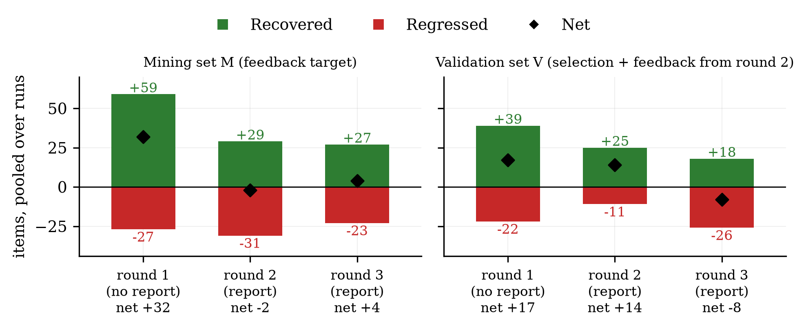
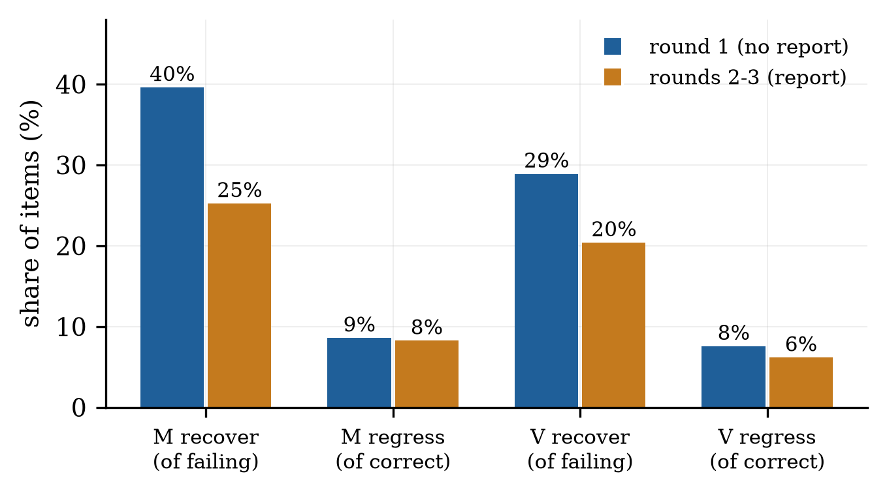
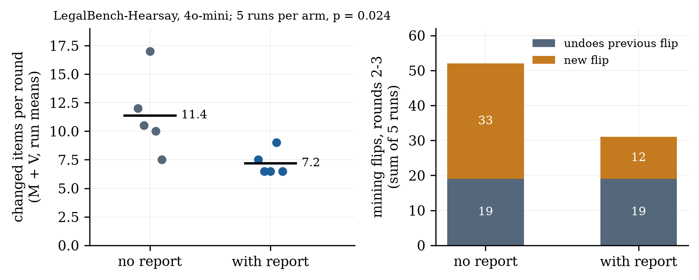
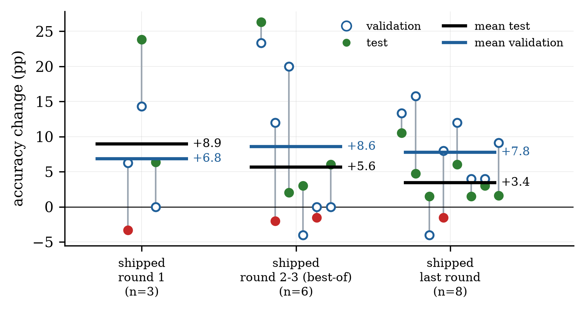

# What the round 2-3 effect reports do to the mining (M) and validation (V) sets

Reproduce everything: `python Docs/round_feedback_analysis/analysis.py` (reads only `results/` and `Paper_COLING/Artifacts/val_test_gap.json`; no paper or code changes).
Population: the 17 optimized records of the paper (19 minus the two high-baseline skips), 49 committed rounds (17 in round 1, 32 in rounds 2-3).

## Bottom line

1. **Almost all measured progress happens in round 1, the round with no effect report.** Over rounds 2-3 the mining set barely moves (net +2) and validation moves little (net +6, and -8 in round 3).
2. **The report does not make the optimizer better at repairing what it broke.** In the controlled ablation, flagged regressions are fixed at the same rate with and without the report.
3. **The report does make the optimizer more conservative.** It cuts *new* collateral flips by about two thirds (12 vs 33 mining flips). Net gain is unchanged.
4. So the honest justification of RFDPO's feedback is **"do-no-harm / stability and auditability"**, not "faster or better optimization". That fits the paper's title and its test-accuracy result (no improvement), but it is a different claim from the current framing.

Strength of evidence: round 1 vs later is observational (not randomized). The ablation is randomized but has 5 runs per arm on one benchmark and solver. I ran about a dozen tests; none is corrected for multiple comparisons.

## 1. Round 1 versus rounds 2-3, pooled

| slice | rounds | M recovered/regressed | M net | V recovered/regressed | V net | sections edited |
|---|---|---|---|---|---|---|
| round 1 (no report) | 17 | 59 / 27 | **+32** | 39 / 22 | +17 | 4.29 |
| round 2 (report) | 16 | 29 / 31 | -2 | 25 / 11 | +14 | 1.56 |
| round 3 (report) | 16 | 27 / 23 | +4 | 18 / 26 | **-8** | 1.12 |
| rounds 2-3 | 32 | 56 / 54 | **+2** | 43 / 37 | +6 | 1.34 |

- The same split holds for non-MMLU runs (M net +13 in round 1, -7 in rounds 2-3) and MMLU subjects (+19 vs +9).
- This reproduces the sentence currently commented out in `paper.tex` ("Later rounds recovered 56 mining examples while regressing 54, compared with 59 recoveries and 27 regressions in round 1"). It is a clean, checkable number.
- Run-level paired comparison (mean of rounds 2-3 net minus round 1 net): M **-1.88**, lower in **12 of 17** runs, sign-flip p = 0.014. V -0.82, lower in 11 of 17, p = 0.42 (not significant).

### Is that just running out of failures to fix?

Partly. After round 1 there are fewer failing items, so I normalized by headroom:

| | round 1 | rounds 2-3 |
|---|---|---|
| M: failing items recovered | 59/149 = **39.6%** | 56/222 = **25.2%** |
| M: correct items regressed | 27/315 = 8.6% | 54/655 = 8.2% |
| V: failing items recovered | 39/135 = 28.9% | 43/211 = 20.4% |
| V: correct items regressed | 22/291 = 7.6% | 37/602 = 6.1% |

The damage rate is flat (about 8%). The *recovery* rate drops by a third. Headroom does not explain that away, but round 1 is also the round that rewrites 4.3 of 5 sections, so "report present" and "big rewrite" are confounded in the main runs. Only the ablation separates them.

## 2. The controlled test: report versus no report (Hearsay, 4o-mini, same replayed round-1 prompt)

| per-run mean over rounds 2-3 | report | no report | permutation p |
|---|---|---|---|
| M regressions | 1.40 | 2.50 | 0.024 |
| V regressions | 0.50 | 1.80 | 0.214 |
| **M+V regressions** | **1.90** | **4.30** | **0.048** |
| **M+V items changing outcome** | **7.2** | **11.4** | **0.024** |
| M+V net gain | 3.4 | 2.8 | 0.675 |

Splitting the mining flips of rounds 2-3 by what they do to the previous round's flips (item IDs):

| mining flips, rounds 2-3, summed over 5 runs | report | no report | p |
|---|---|---|---|
| flip that **undoes** the previous round's flip | 19 | 19 | per run 3.8 vs 3.8, p = 1.00 |
| **new** flip (item untouched by the previous round) | **12** | **33** | per run 2.4 vs 6.6, **p = 0.016** |
| flagged-as-regressed items recovered next round | 10/26 (38%) | 14/28 (50%) | Fisher p = 0.43 |

Reading: the report's entire effect is on **new** changes. It leaves repair and ping-pong unchanged, and it stops the optimizer from disturbing items that were fine. This is the "item-level feedback reduced churn but not accuracy" result in the paper, now with a mechanism.

## 3. A trap to avoid: the "repair" statistic in the main runs

In the main runs, items flagged as just-regressed are recovered next round **57%** of the time (32/56), against **14%** for other still-wrong items (Fisher p = 2e-9). It looks like proof the report works. It is not:

- The no-report arm shows the same thing (50% vs 32%), so most of it is borderline items flipping back (regression to the mean).
- 51.5% of rounds 2-3 mining flips (53/103) simply reverse the previous round's flip.
- 54.6% of all mining flips (107/196) are on items that flipped at least twice.

Do not use the 57% vs 14% number as evidence for the report. It does support a different, safe statement: a large share of churn sits on a small set of unstable items, consistent with the paper's re-evaluation-noise caveat.

## 4. Validation: is it being overfit by the feedback?

Validation is hidden from the optimizer in round 1 and shown in full from round 2 on.

- V net by round: +17, +14, **-8**. No sign of validation being steadily inflated; round 3 goes negative.
- Validation gain and test change by which round shipped (suggestive only, n is tiny, and the selection rule differs between groups):

| shipped round | n | mean dV | mean dT | dV - dT |
|---|---|---|---|---|
| round 1 (V still blind) | 3 | +6.8 | +8.9 | -2.1 |
| round 2-3, best-of-rounds | 6 | +8.6 | +5.6 | +2.9 |
| last round (8 runs, older rule) | 8 | +7.8 | +3.4 | +4.3 |

The ordering is what a "validation exposure inflates validation gains" story would predict, but I would not claim it from 3 / 6 / 8 runs.

## What I could not answer

- **No per-round test scores are saved** (only one PUPA `round2_test_eval.json`). So I cannot say whether rounds 2-3 help or hurt held-out accuracy, which is the most important question here. `scripts/eval_round_on_test.py` already exists for this. Evaluating the shipped and non-shipped rounds of the 17 runs would cost one test pass per round (API cost; I did not run it).
- The ablation is one benchmark, one solver, 5 runs per arm. The new-flip result (p = 0.016) would not survive a Bonferroni correction over my roughly twelve tests, so treat it as exploratory.

## Suggested angles for the paper (your call; I changed nothing)

1. **Add the round 1 vs 2-3 table and Figure 1.** It is the clearest new item-level finding: gains arrive early, later rounds reshuffle. It also fits the TMLR "findings, even negative" framing.
2. **Reframe the report's value as stability.** "Cuts collateral flips by about two thirds at equal net gain" is supported; "improves optimization" is not.
3. **Use the new-vs-reversal split to sharpen the ablation paragraph.** It explains the 3.1 vs 5.2 churn result instead of just reporting it.
4. **Suggest a practical corollary, carefully:** if most gain is in round 1, fewer rounds may be enough. This needs the per-round test scores before it can be stated.
5. **Highest-value experiment:** per-round test evaluation, ideally with a second seed on a few configurations.

Files: `Docs/round_feedback_analysis/analysis.py`, `fig1_rounds_pooled`, `fig2_headroom_rates`, `fig3_ablation_mechanics`, `fig4_shipped_round_gap` (png and pdf).
