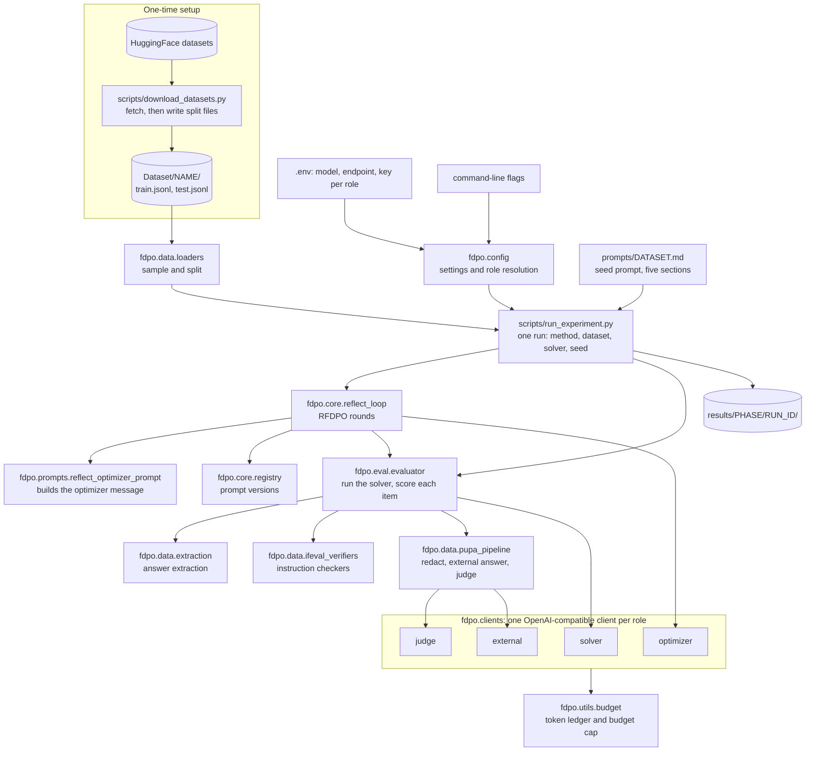
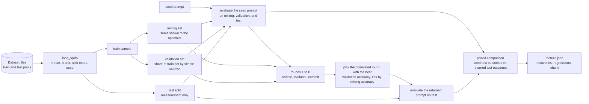
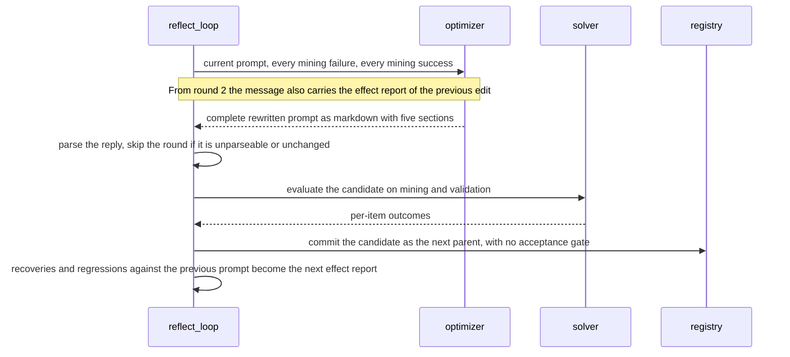

# FDPO: Reflective Feedback-Driven Prompt Optimization (anonymous source)

Code for the paper's experiments. A *solver* model answers benchmark items with
a task prompt, an *optimizer* model rewrites that prompt over several rounds,
and every evaluation is logged item by item. Each prompt version's recoveries
(wrong to right), regressions (right to wrong), and churn can therefore be read
back from the run outputs. The paper's method (RFDPO) is `--method reflect_fdpo`.

This is a source submission. Author identity, Git history, private environment
files, run outputs, and dataset corpora are not included, and it is not a release
of the paper's per-item result traces.

## Quick start

```bash
uv sync --frozen                    # install the pinned environment
cp .env.example .env                # then add your API keys and endpoints
uv run python -m scripts.run_experiment --method reflect_fdpo \
  --dataset legalbench_hearsay --dry-run     # offline check: mock client, no API calls
```

On Windows PowerShell use `Copy-Item .env.example .env`, and write multi-line
commands on one line or end each line with a backtick instead of a backslash.

## How it works

### Architecture



### Data flow of one run

The test split never reaches the optimizer. It is evaluated twice: once with the
seed prompt and once with the returned prompt.



If the seed's mining accuracy is already at or above `--skip-above-acc`, or no round
is committed, the seed is kept and its test result is reused.

### One optimization round



The effect report lists the sections the last edit changed (with their previous
text), the mining and validation items it recovered, and the items it regressed
together with the solver's new wrong answer. Rounds stop early when fewer than
`--tau` mining failures remain.

### Prompt format

A prompt has five sections in a fixed order: System Role, Context, Task Details,
Constraints, and Output Format. Seed prompts are markdown files with one `## Section`
header per section. The optimizer returns the whole prompt as markdown; sections it
omits are filled from the current prompt, and `--pin-sections` freezes chosen
sections. Every committed change is stored in `registry.json`. A seed given with
`--prompt-file` that has no section headers is placed in Task Details, and the
optimizer builds the other sections.

### How items are scored

| Benchmark | An item counts as correct when |
|---|---|
| `legalbench_hearsay` | the extracted Yes or No answer equals the gold label |
| `mmlu` | the extracted answer letter equals the gold letter |
| `aime` | the extracted final number equals the gold integer (a `####` line is preferred, otherwise the last number) |
| `ifbench` | every instruction's checker in `fdpo.data.ifeval_verifiers` passes on the response; items the checkers do not fully cover are filtered out when loading |
| `pupa` | the composite (quality + 1 - leakage) / 2 is at least 0.7. Only the redaction prompt is optimized: the solver redacts the query, a fixed external model answers it, the solver writes the final response with a frozen instruction, the judge scores quality, and leakage is the fraction of annotated private strings left in the redacted query |

An answer that cannot be extracted counts as wrong and is tallied as an extraction
failure in `metrics.json`. Items that a provider's content filter refuses are marked
blocked and excluded from the accuracy denominator.

### Data splits

| `--split-mode` | Test items | Train items |
|---|---|---|
| `seeded` (default) | random for each seed | random for each seed |
| `stratified` | fixed across seeds, stratified by slice, subject, or gold label, drawn from the pooled train and test files | stratified, seed-dependent, from the remaining items |
| `balanced` | `--n-test` per subject, fixed across seeds | `--n-train` per subject, seed-dependent |

The train items are then divided into the mining and validation sets, stratified,
with `--simple-val-frac` as the validation share.

### Item-level transitions

For two prompts evaluated on the same items, the recovered items R are wrong under
the first prompt and right under the second, and the regressed items G are the
reverse. Net change is |R| - |G| and churn is |R| + |G|. `metrics.json` records these
for each round on the mining and validation sets (`rounds_log`) and for the seed
versus the returned prompt on the test set (`test_confusion`).

## 1. Install

Requires Python 3.12 and [uv](https://docs.astral.sh/uv/). The environment is
pinned by `uv.lock`:

```bash
uv sync --frozen
```

## 2. Configure the models

Copy `.env.example` to `.env`. Each role takes `_MODEL`, `_BASE_URL`,
`_API_KEY`, and `_API_VERSION`:

| Role | Used for |
|---|---|
| `SOLVER_*` | the model whose prompt is optimized and evaluated |
| `OPTIMIZER_*` | the model that rewrites the prompt |
| `JUDGE_*` | PUPA quality scoring and the older `fdpo` method; the loader still requires it to be set |
| `EXTERNAL_*` | PUPA only: the untrusted model that answers the redacted request |

Any OpenAI-compatible endpoint works. For Azure OpenAI, set `API_VERSION` and the
resource endpoint; a non-empty `API_VERSION` selects the Azure client. For a local
OpenAI-compatible server, use its model identifier and base URL, a non-empty dummy
API key, and an empty `API_VERSION`. The placeholders in `.env.example` are not
secrets.

## 3. Download and split the data

```bash
uv run python -m scripts.download_datasets --dataset all
uv run python -m scripts.download_datasets --dataset legalbench_hearsay ifbench   # or a subset
```

The downloader fetches each benchmark from HuggingFace and writes the train/test
split files `Dataset/<name>/{train,test}.jsonl`. Experiment runs read only these
files and never contact HuggingFace. Dataset files are not included in this
archive because they are third-party corpora, and PUPA contains personal
information. Check each dataset's license and data-use terms before downloading
or sending examples to a hosted API.

| Benchmark in the paper | `--dataset` | Notes |
|---|---|---|
| LegalBench Hearsay | `legalbench_hearsay` | use `--split-mode stratified` |
| MMLU, six subjects | `mmlu` | one subject per run: `--subjects <name> --split-mode balanced` |
| IFBench | `ifbench` | |
| AIME | `aime` | |
| PUPA | `pupa` | needs the `EXTERNAL_*` role |

The MMLU subjects are `college_mathematics`, `philosophy`, `econometrics`,
`high_school_biology`, `professional_law`, and `computer_security`. `gsm8k`, `arc`,
`legalbench_contract_nli`, and `ifeval` are also available.

## 4. Check the install

```bash
uv run python -m pytest
```

The tests use mock model clients and make no paid API calls. Some read the
downloaded dataset files, so run step 3 first for a complete pass.

## 5. Run an experiment

Seed prompts are in `prompts/`; `prompts/<dataset>.md` is used unless
`--prompt-file` is given. All parameters are command-line flags; see
`uv run python -m scripts.run_experiment --help`.

The paper's main runs use GPT-4o-mini and GPT-4.1 Mini as solvers and GPT-5 as the
optimizer, set in `.env` (`SOLVER_MODEL`, `OPTIMIZER_MODEL`); run each command once
per solver. These are the settings recorded in the completed runs:

```bash
# LegalBench Hearsay: 50 train (25 mining / 25 validation), 49 test
uv run python -m scripts.run_experiment --method reflect_fdpo \
  --dataset legalbench_hearsay --seed 0 --n-train 50 --n-test 49 \
  --split-mode stratified --simple-val-frac 0.5 --simple-max-rounds 3 \
  --tau 1 --skip-above-acc 0.95 --phase hearsay

# MMLU: one subject per run (50 train, 66 test each)
uv run python -m scripts.run_experiment --method reflect_fdpo --dataset mmlu \
  --prompt-file prompts/mmlu_oneliner.md --subjects econometrics --seed 0 \
  --n-train 50 --n-test 66 --split-mode balanced --simple-val-frac 0.5 \
  --simple-max-rounds 3 --tau 1 --skip-above-acc 0.95 --max-workers 3 \
  --phase mmlu_econometrics

# IFBench: 40 train, 42 test
uv run python -m scripts.run_experiment --method reflect_fdpo --dataset ifbench \
  --seed 0 --n-train 40 --n-test 42 --split-mode stratified \
  --simple-val-frac 0.5 --simple-max-rounds 3 --tau 1 --skip-above-acc 0.95 \
  --phase ifbench

# AIME: 90 train (58 mining / 32 validation), 30 test
uv run python -m scripts.run_experiment --method reflect_fdpo --dataset aime \
  --seed 0 --n-train 90 --n-test 30 --split-mode seeded \
  --simple-val-frac 0.35 --simple-max-rounds 3 --tau 1 --skip-above-acc 0.95 \
  --phase aime

# PUPA: 60 train, 40 test; needs the EXTERNAL_* role in .env
uv run python -m scripts.run_experiment --method reflect_fdpo --dataset pupa \
  --seed 0 --n-train 60 --n-test 40 --split-mode stratified \
  --simple-val-frac 0.5 --simple-max-rounds 3 --tau 1 --max-workers 4 \
  --phase pupa
```

The MMLU subjects are `college_mathematics`, `philosophy`, `econometrics`,
`high_school_biology`, `professional_law`, and `computer_security`. A few runs differ
from the commands above: AIME runs with GPT-4.1 Mini set `--solver-max-tokens`
between 4096 and 16000 so answers were not truncated, and some IFBench runs used
`--simple-val-frac 0.35`. Every run's `config.json` records its exact flags.

- `--dry-run` swaps in a mock client and synthetic data: no API calls, no cost,
  and no dataset download needed.
- `--n-train` and `--n-test` set how many items are drawn; `--simple-val-frac` is
  the share of the training pool held out as validation, and the test split is
  used only for measurement.
- `--simple-max-rounds` is the number of optimizer rounds. `--tau` is the minimum
  number of baseline failures that triggers optimization, and `--skip-above-acc`
  keeps the seed when baseline accuracy is already at or above that value.
- `--budget-usd` caps spend per run (default 4; `<= 0` disables the cap). Spend is
  computed from a built-in price table; pass `--price-in` and `--price-out` ($ per
  million tokens) for other models.
- `--accept-margin` is accepted but has no effect on `reflect_fdpo`, which has no
  revert-to-seed gate; some recorded runs set it to different values.
- `--no-effect-report` withholds the item-level effect report from the optimizer,
  and `--round1-prompt-file` replays a fixed round-1 prompt; together they give the
  effect-report comparison.
- Methods: `zeroshot_cot`, `fewshot_cot`, `monolithic`, `fdpo`, `simple_fdpo`, and
  `reflect_fdpo`. `reflect_fdpo` returns the best committed validation candidate,
  breaking ties by mining accuracy, and returns an edited prompt whether or not it
  beats the seed. Historical runs used earlier variants, and this archive does not
  claim to freeze every historical experiment version; each run's `config.json`
  records its exact settings.

## 6. Read the results

Each run writes `results/<phase>/<run_id>/`:

```
config.json       resolved settings (no secrets)
metrics.json      seed and final test accuracy, plus the optimization summary
eval_log.csv      per-item test results for the seed and the final prompt
prompt_baseline.md, prompt_current.md   the seed prompt and the prompt at the end of the run
registry.json     version history of the prompt
ledger.csv        every API call: role, model, tokens, cost
run.log, calls/   run log and raw call records
```

The item-level transitions are in `metrics.json` under `optimization`:
`test_confusion` (recoveries, regressions, still wrong, net gain) for the test
split, `train_confusion` for the tuning data, and `rounds_log` per round.

## Troubleshooting

- `FileNotFoundError: Dataset/... not found`: run step 3 for that dataset.
- Empty completions, or errors against a local server: a non-empty `*_API_VERSION`,
  or any `AZURE_OPENAI_*` variable, selects the Azure client. Leave them unset for
  ordinary OpenAI-compatible endpoints, and use a non-empty dummy key.
- A run stopped at the spend cap: `metrics.json` has `status` set to
  `budget_aborted`, and the partial results are saved. Raise `--budget-usd` to continue.
- A round is missing from the trajectory: `rounds_log` marks it `parse_failed`,
  `no_change`, or `below_tau`, and the loop moves on or stops.
- Many extraction failures on long reasoning tasks (AIME): raise `--solver-max-tokens`
  so the final answer is not truncated.
- Re-evaluating an unchanged prompt can flip a few items, because hosted models are
  not fully deterministic. Compare runs through the paired transitions, not a single
  accuracy difference.
- PUPA needs the `EXTERNAL_*` role in `.env`; without it the run stops at start-up
  and reports that `EXTERNAL_MODEL` is not set.

## Containers

After configuring `.env`, downloading the data, and building:

```bash
docker compose build
docker compose run --rm fdpo python -m scripts.run_experiment --help
```

The image is the orchestrator only, not a model server. The compose setup uses
host networking intended for Linux; Docker Desktop users must configure reachable
endpoints. Outputs are written to `results/`, which starts absent from this archive.

## Repository layout

```
.
|-- README.md, pyproject.toml, uv.lock, .python-version, .env.example
|-- Dockerfile, docker-compose.yml
|-- src/fdpo/
|   |-- config.py        settings and per-role model resolution from .env
|   |-- clients/         OpenAI-compatible client, mock client for --dry-run, stub
|   |-- core/            reflect_loop (RFDPO), simple_loop (control without the effect
|   |                    report), loop (older fdpo and monolithic methods), registry
|   |                    (prompt versions), prompt, gate, judge
|   |-- data/            loaders and splits, hf_fetch, extraction, ifeval_verifiers,
|   |                    pupa_pipeline, md_prompt
|   |-- eval/            evaluator and metrics
|   |-- prompts/         optimizer message builders and built-in seed prompts
|   `-- utils/           budget and token ledger, io, logging
|-- scripts/
|   |-- download_datasets.py   dataset download and split files
|   `-- run_experiment.py      one run: method x dataset x solver x seed
|-- prompts/             seed task prompts and their variants
|-- tests/               unit and integration tests with mock model clients
|-- _dl/                 analysis scripts that read run outputs (not included)
|-- oracle_leak_check.py test-exposure diagnostic, not a held-out result
|-- Codebase.md          notes on the code's mechanics
`-- ANONYMIZATION.json   export scope, redaction counts, and file hashes
```

Some strings may be replaced by the placeholder `anonymous`. No license is
stated for this review copy.
